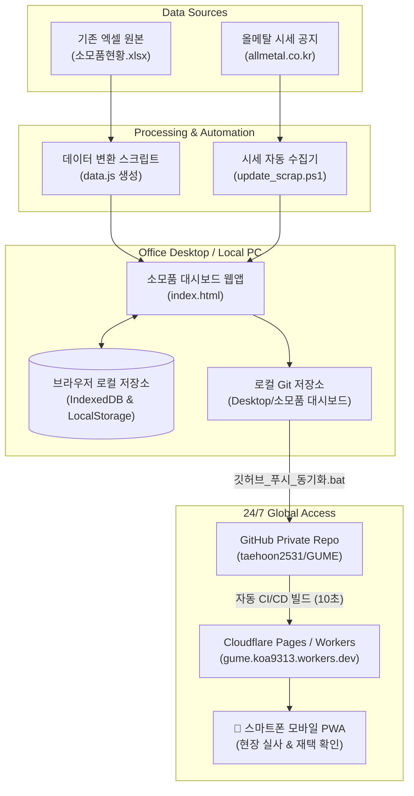

# 📄 [PRD] (주)에스앤더블류 소모품 구매 관리 및 폐초경 시세 모니터링 대시보드

---

## 📌 1. 문서 개요 (Document Overview)

| 항목 | 내용 |
| :--- | :--- |
| **프로젝트명** | (주)에스앤더블류 소모품 구매 관리 및 폐스크랩 시세 분석 대시보드 |
| **시스템 영문명** | SNW Supplies Procurement Management & Scrap Market Intelligence System |
| **문서 버전** | v2.8 (구매부 실무 체크 메모장 & 실시간 자동저장 위젯 탑재 에디션) |
| **작성 부서 / 작성자** | 구매부 / 김태훈 주임 (`taehoon2531`) |
| **최종 갱신일** | 2026년 11월 16일 |
| **온라인 배포 주소** | `https://gume.koa9313.workers.dev` (Cloudflare Pages/Workers 연동) |
| **원격 코드 저장소** | Private GitHub Repository (`https://github.com/taehoon2531/GUME`) |

---

## 🎯 2. 프로젝트 배경 및 목적 (Background & Objectives)

### 2.1 추진 배경
1. **엑셀 수동 관리의 한계 극복**
   - 기존에는 45,000건 이상의 방대한 소모품(가공용 인서트 팁, 엔드밀, 드릴, 테이프, 절삭유 등) 구매 내역을 단일 엑셀 파일(`소모품현황.xlsx`)로 관리.
   - 데이터 누적으로 파일 용량이 비대해져 검색·필터링 속도가 현저히 저하되고, 다중 사용자 수정 시 데이터 충돌 및 유실 위험 상존.
2. **품목별 과거 단가 변동 및 거래처 추이 분석 부재**
   - 특정 공구(예: CNMG 인서트 등)의 3~5개년 단가 인상/인하 이력을 즉시 추적하기 어려워, 공급사 견적 검토 시 협상력 발휘에 제약.
   - 월별·거래처별 매입액 추이 및 피벗 분석을 엑셀로 매번 수작업 정리해야 하는 비효율 발생.
3. **공장 내 고부가가치 폐스크랩(폐초경·폐하이스) 매각 자산화 체계화**
   - 기계 가공 공정 후 발생하는 폐인서트 팁, 통초경 엔드밀, HSS 하이스 공구는 고단가 유가금속(텅스텐, 코발트) 자산임에도 불구하고 시장 시세 추적 체계가 없었음.
   - 국내 최대 금속스크랩 거래소(올메탈)의 공지 단가(kg당 33,000원 ~ 100,000원 급변동)를 모니터링하여 **최고가 매각 타이밍을 포착**할 필요성 대두.
4. **시공간 제약 없는 모바일 및 원격 업무 지원**
   - 사무실 PC 앞에서만 데이터를 볼 수 있었던 환경을 탈피하여, 공장 현장 실사, 출장, 재택근무 시에도 스마트폰으로 즉시 단가와 시세를 확인할 수 있는 시스템 요구.

### 2.2 핵심 목표 (Key Objectives)
- **속도 혁신**: 45,000+건 대용량 데이터를 0초(지연 없음) 단위로 실시간 검색·필터링.
- **원가 절감**: 품목별 단가 이력 차트를 통한 거래처 견적 타당성 검증 및 단가 인하 협상 기반 마련.
- **수익 극대화**: 폐초경 및 하이스 시세 144회차 변동 추이 모니터링과 매각 간이 계산기를 통해 최적기 매각 수익 창출.
- **업무 자동화**: 월마감 보고서 인쇄 및 엑셀 명세서 편집, 깃허브 푸시, Cloudflare 자동 배포 원클릭화.

---

## 👥 3. 사용자 페르소나 및 핵심 유스케이스 (User Personas & Use Cases)

| 페르소나 | 주요 사용 목적 | 핵심 유스케이스 (Use Cases) |
| :--- | :--- | :--- |
| **구매부 담당자**<br>(주 사용자) | 일상 소모품 발주 검토,<br>거래처 단가 비교, 월마감 정산 | • 신규 발주 전 품목명을 검색하여 최근 3개년 최저·최고 단가 확인<br>• 월말 거래처별 매입액 자동 집계 및 거래명세서 A4 보고서 출력<br>• 엑셀 복사/붙여넣기를 통한 신규 입고 데이터 즉시 웹 동기화 |
| **공장 가공 현장 관리자** | 공구 폐기물 수거 및<br>스크랩 매각 시점 결정 | • 공구실에 모인 폐초경 팁 및 폐하이스 중량 측정 후 예상 매각 대금 계산<br>• 올메탈 주차별 시세가 저점 반등 구간인지 확인 후 고물상 수거 일정 확정 |
| **구매팀장 및 임원** | 구매 예산 통제 및<br>업체별 편중도 모니터링 | • 거래처별 매입추이 그래프에서 주요 벤더별 연간 매입 비중 확인<br>• 스마트폰으로 외부에서도 특정 규격 단가 및 월마감 현황 신속 결재·참조 |

---

## 🏗️ 4. 시스템 아키텍처 및 기술 스택 (System Architecture)

본 시스템은 외부 서버 비용이 발생하지 않고(100% Free Tier), 보안성이 뛰어나며, 인터넷 연결이 불안정해도 로컬에서 완벽하게 작동하는 **Local-First & Serverless JAMstack** 아키텍처를 채택했습니다.



### 4.1 기술 스택 명세

| 구분 | 적용 기술 | 선정 이유 및 역할 |
| :--- | :--- | :--- |
| **프론트엔드 코어** | Pure HTML5, CSS3, ES6+ JavaScript | 무거운 프레임워크(React/Vue 등) 없이 빌드 의존성을 배제하여 단일 파일(`index.html`)만으로 초경량·초고속 로딩 보장 |
| **차트 엔진** | HTML5 Native Canvas API | 무거운 외부 차트 라이브러리 없이 픽셀 단위로 커스텀 렌더링. 마우스 호버 툴팁, 크로스헤어, 다크모드 실시간 색상 반전 지원 |
| **클라이언트 스토리지** | IndexedDB, Web LocalStorage | 45,000건 대용량 데이터의 브라우저 로컬 인덱싱 및 명세서 편집 캐시 보존 |
| **타이포그래피** | Pretendard Variable CDN | 숫자 및 코드 가독성에 최적화된 고품질 고딕 웹폰트 적용 |
| **버전 관리** | MinGit (v2.56.1), GitHub | 사내 구매 단가 보호를 위한 **Private(비공개) 저장소** 운용 |
| **클라우드 호스팅** | Cloudflare Pages / Workers | 무제한 대역폭, 무료 SSL, 깃허브 푸시 시 자동 배포 (무서버 24시간 가동) |
| **운영 자동화** | Windows PowerShell 5.1, Batch Scripts | 원클릭 깃허브 푸시/풀, 올메탈 시세 자동 웹크롤러 |

---

## 🧩 5. 상세 기능 명세 (Functional Specifications)

### 📊 공통 상단: 실시간 총 거래금액 & 구매부 실무 체크 메모장 위젯
- **핵심 총 거래금액 단독 집중 표출 (간소화)**:
  - 사용자 피드백을 반영하여 거래수량, 가중 평균단가, 데이터건수 등 불필요한 보조 지표 카드를 제거하고, 구매 관리의 핵심 지표인 **`총 거래금액` 카드만 단독으로 표출 (너비 290px 유지)**.
- **📌 구매부 실무 체크 메모장 (Quick Memo / 포스트잇 보드, 신규)**:
  - 총 거래금액 카드 우측의 남는 공간을 꽉 채우는 전용 실무 메모장 탑재 (`flex: 1; min-width: 320px;`).
  - **무손실 실시간 자동 저장 (`LocalStorage`)**: 타이핑하는 즉시 브라우저 로컬 저장소에 보존되어, PC를 재부팅하거나 브라우저를 새로고침해도 메모가 영구 유지됨.
  - **원클릭 편의 기능**: 자동저장 상태 뱃지(`● 자동저장`), 원클릭 메모 전체 비우기(`[비우기]`), 클립보드 원클릭 복사(`[복사]`) 지원.
  - 다크모드 완벽 대응 (다크모드 전환 시 눈이 편안한 웜그레이/골드 톤 테마 자동 적용).
- **3대 카테고리(소모품/부자재/원자재) 실시간 금액 자동 동기화**:
  - `소모품 검색 & 상세 (tab-search)` 진입 시: 소모품 기준 **총 거래금액** 실시간 연동.
  - `부자재 검색 & 상세 (tab-sub)` 진입 시: 부자재 기준 **총 거래금액** 실시간 연동.
  - `원자재 검색 & 상세 (tab-raw)` 진입 시: 원자재 기준 **총 거래금액** 실시간 연동.
- **최종 등록일자(마지막 입고일) 상시 표기 뱃지 3종**:
  - KPI 상단 바에 `📋 소모품 최종: 2026-11-13`, `🧱 부자재 최종: 2026-11-10`, `🏭 원자재 최종: 2026-11-13`을 상시 고정 표시하여, 사용자가 언제든 다음번 데이터 수집 시작 시점을 즉시 파악 가능.
- **상단 원터치 데이터셋 스위처 & 뱃지**:
  - `[📋 소모품]` / `[🧱 부자재]` / `[🏭 원자재]` 퀵 토글 버튼 탑재 (클릭 시 해당 카테고리 탭 자동 전환 및 총 거래금액 즉시 갱신).
- **데이터 필체 단일화 (Pretendard & Tabular-nums 적용)**:
  - 소모품, 부자재, 원자재 테이블 전체에서 제각각이던 고정폭(monospace) 글꼴을 완전히 배제하고 고품질 고딕인 **Pretendard 서체로 일원화**.
  - `tabular-nums`(자폭 고정 숫자) 기술을 적용하여 글씨체의 심미성을 유지하면서도 숫자의 자릿수 정렬과 가독성을 극대화.

---

### 📋 모듈 1: 소모품 검색 및 품목별 단가 이력 분석 (`tab-search`)
- **실시간 다차원 필터링**: 품명, 규격, 공급사(업체명), 비고를 입력하는 즉시 0ms 단위로 실시간 검색.
- **업체명(거래처) 단독 직관 검색창 탑재**: 툴바 내 별도 업체명 검색 입력창 및 자동완성(Datalist) 지원으로 특정 거래처만 즉시 분리 검색 가능.
- **기간 범위 지정 및 마지막 등록일 뱃지**:
  - 시작일~종료일 캘린더 피커 바로 옆에 **`마지막 등록일: 2026-11-13`** 안내 뱃지 탑재.
- **원클릭 빠른 검색 칩스 (Mobile/Desktop)**: `[전체]`, `[인서트]`, `[엔드밀]`, `[드릴]`, `[테이프]`, `[오일]`, `[장갑]`, `[가스]` 터치 시 즉시 필터링.
- **단가 변동 뱃지 및 숫자 시각 위계**:
  - 품명+규격 기준 직전 입고 단가를 자동 대조하여 **`▲ +X% 인상` (빨강)**, **`▼ -X% 인하` (파랑)**, **`= 보합` (회색)**, **`신규` (하늘색)** 뱃지를 단가 셀에 인라인 표시.
  - 마우스 호버 시 "직전 거래가 대비 변동률" 상세 툴팁 제공.
  - 단가는 굵은 글씨/모노스페이스, 공급가액은 기본 네이비 포인트 컬러, 수량은 보조 폰트로 시각 위계 정립.
- **품목별 과거 단가 변동 팝업 차트**:
  - 행(Row) 클릭 시 모달 창 호출.
  - 해당 품목의 과거 전 회차 입고 단가를 시간순 꺾은선 캔버스 그래프로 시각화 (최저/최고/평균 뱃지 및 전회 대비 변동률 자동 산출).
  - 최근 1년, 3년, 5년, 전체 기간 필터링 버튼 제공.
- **데이터 내보내기**: 현재 필터링된 검색 결과를 UTF-8 BOM CSV(엑셀 호환) 파일로 즉시 다운로드.

---

### 🧱 모듈 1-2: 부자재 검색 및 품목별 단가 이력 분석 (`tab-sub`)
- **44,185건 ERP 부자재 데이터베이스 내장**: 2008년~2026년 11월 환봉(절단), 볼트, 너트, 와셔, 플레이트, 단조품 등 전체 부자재 입고 내역 탑재.
- **넓고 쾌적한 4열 멀티 검색 카드 (Multi-Field Search Card)**:
  - 🏢 **업체명**, 📦 **품명**, 🪨 **재질**, 📐 **규격** 전용 자동완성 Datalist 제공.
- **맞춤 카테고리 퀵 칩스 및 마지막 등록일 뱃지**:
  - `[전체]`, `[⚪ 환봉/절단]`, `[🔩 볼트]`, `[🛑 너트]`, `[🔘 와셔]`, `[🔲 플레이트]`, `[⚙️ 단조품]`, `[💿 디스크]`, `[📌 핀/기타]`.
  - 입고기간 필터 바로 옆에 **`마지막 등록일: 2026-11-10`** 안내 뱃지 탑재.
- **9개 컬럼 정밀 테이블 & 재질 뱃지 표시**:
  - `입고일자`, `업체명`, `품명`, `재질 (🪨 뱃지)`, `규격`, `수량`, `단가`, `공급가액`, `비고`.
  - 품명+규격+재질 매칭 기반 **단가 변동 뱃지(▲ 인상 / ▼ 인하 / = 보합 / 신규)** 적용.
- **부자재 거래처 사이드바 & TOP 10 품목**: 공급업체별 매입 순위 및 선택 업체의 주요 품목 즉시 확인.
- **품목별 과거 단가 변동 Canvas 차트 연동 & CSV 내보내기**.

---

### 🏭 모듈 1-3: 원자재 검색 및 품목별 단가 이력 분석 (`tab-raw`, 신규)
- **33,115건 ERP 원자재 데이터베이스 내장 (신규)**:
  - 2008년 10월부터 2026년 11월 13일까지 18개년간의 원자재 입고 데이터 33,115건 정밀 탑재 (누적 매입액 약 2,448억 원).
  - 총 33,409행 중 ERP상 동일 일자·업체·품명·규격·수량·단가 중복 293건을 사전에 정밀 자동 제외하여 무결점 데이터베이스 구축.
- **4열 직관 멀티 검색 카드 (Multi-Field Search Card)**:
  - 🏢 **업체명**: 세한스틸, 삼양종합특수강, 세화특수강, 진스틸 등 111개 원자재 공급사 자동완성 Datalist 지원.
  - 📦 **품명**: ROUND BAR (31,315건), HEX BAR (457건), PLATE (106건), SEAMLESS TUBE, FLAT BAR 등 원자재 주요 품종 자동완성.
  - 🪨 **재질**: S45C, SCM440, SNCM439, SUS304, A564-630, SKD61, 42CrMo4 등 수백 종 강종/원자재 재질 Datalist 연동.
  - 📐 **규격**: 외경(Ø), 두께, 길이 등 원자재 특화 규격 자동완성 지원.
- **원터치 원자재 형상/품종 퀵 칩스**:
  - `[전체]`, `[⚪ ROUND BAR]`, `[🛑 HEX BAR]`, `[🔲 PLATE]`, `[🔩 FLAT BAR]`, `[⚙️ TUBE/PIPE]`, `[📌 기타]` 즉시 필터링.
  - 기간 필터 바로 옆에 **`마지막 등록일: 2026-11-13`** 안내 뱃지 탑재.
- **9컬럼 정밀 테이블 & 재질 뱃지 & 단가 변동 인라인 뱃지**:
  - `입고일자`, `업체명`, `품명`, `재질 (🪨 뱃지)`, `규격`, `수량`, `단가`, `공급가액`, `비고(강종/사양/단위)`.
  - 직전 회차 거래 대비 단가 인상/인하/보합/신규 뱃지 표시 및 시각 위계(모노스페이스 굵은 단가, 에메랄드 포인트).
- **원자재 공급사 랭킹 사이드바 & 주요 품목 TOP 10**:
  - 세한스틸(주), 삼양종합특수강 등 원자재 핵심 벤더 순위 및 선택 시 해당 거래처 품목 집중 분석.
- **품목별 과거 단가 변동 Canvas 차트 연동 & CSV 내보내기**:
  - 행 클릭 시 품명+규격+재질 매칭 과거 전 회차 원자재 입고 단가 캔버스 꺾은선 차트 및 최저/최고/평균 통계 팝업.
  - 필터링된 원자재 목록 원클릭 UTF-8 BOM CSV 다운로드.

---

### 📈 모듈 2: 거래처별 매입추이 피벗 분석 (`tab-trends`)
- **거래처 직접 검색/입력창 & 자동완성 Datalist 탑재**:
  - 피벗 툴바에 전용 거래처 입력창(`🏢 거래처명 검색/선택...`) 탑재.
  - 활성화된 데이터셋(소모품 140여 개사, 부자재 150여 개사, 원자재 111개사)의 거래처 목록이 `datalist`를 통해 타이핑 즉시 자동완성 추천.
  - 입력 실시간으로 피벗 크로스탭 표와 1년 누적 랭킹 목록이 압축 필터링되며, `(검색 N개사 / 전체 M개사)` 현황 뱃지 출력.
  - 엔터 키 입력 또는 자동완성 클릭 시 해당 거래처 단독 월별 매입추이 그래프 및 TOP 5 품목 차트로 즉시 연동 포커스.
  - 원클릭 초기화(`✕`) 버튼으로 전체 거래처 목록 즉각 복원 지원.
- **소모품 vs 부자재 vs 원자재 3원 원클릭 데이터셋 전환**:
  - 상단 컨트롤바에 `[📋 소모품]` / `[🧱 부자재]` / `[🏭 원자재]` 세그먼트 토글 스위처 및 현재 모드 뱃지 제공.
  - 소모품(블루 테마), 부자재(앰버/골드 테마), 원자재(에메랄드 그린 테마)로 시각적 구분 명확화.
  - 원자재 전환 시 33,000여 건 원자재 거래처(세한스틸, 삼양종합특수강, 세화특수강 등)의 월별 매입 흐름과 1년 누적 랭킹 즉시 연동.
  - 피벗 테이블 내 거래처 검색 아이콘(🔍) 클릭 시, 소모품은 `tab-search`, 부자재는 `tab-sub`, 원자재는 `tab-raw`로 정확히 분기 이동하여 해당 거래처 상세 내역 자동 선택.
- **동적 피벗 매트릭스**:
  - 가로축: 월별(YYYY-MM, 최근 12개월/24개월/36개월/전체 선택).
  - 세로축: 거래처 목록.
  - 교차점: 해당 월 거래처 매입 공급가액 합산액 및 히트맵 명도 표시.
- **상호작용형 월별 매입 추이 막대 그래프**:
  - 그래프 막대에 마우스 포인터 호버 시 **해당 월 거래처명, 매입액, 구매 건수 툴팁** 표시.
  - 피벗 테이블 하단 거래처명을 클릭 시, **해당 거래처 단독 매입 그래프로 즉시 연동 필터링**.
- **매입 상위 TOP 벤더 및 품목 비중 차트**: 매입 집중도 파악을 위한 랭킹 바 차트 제공 (거래처 선택 시 해당 거래처의 매입 TOP 5 품목 차트로 동적 전환).
- **피벗 엑셀(CSV) 저장**: 활성화된 데이터셋(소모품/부자재/원자재) 및 거래처 검색 필터에 맞추어 `소모품_거래처별매입추이_YYYY-MM-DD.csv`, `부자재_거래처별매입추이_YYYY-MM-DD.csv`, `원자재_거래처별매입추이_YYYY-MM-DD.csv` 파일 자동 생성.

---

### 📅 모듈 3: 월마감 결산 및 거래처별 구매현황 보고서 (`tab-closing`)
- **월마감 자동 집계**: 대상 연월 및 거래처를 선택하면 해당 월 입고 데이터 자동 추출.
- **공식 A4 규격 거래명세서 양식 출력**:
  - (주)에스앤더블류 회사 정보, 공급자 정보, 품목명, 규격, 수량, 단가, 공급가액, 세액 자동 산출.
  - 브라우저 인쇄(`Ctrl+P`) 시 보고서 외 UI 요소를 숨기고 A4 1장에 맞춘 깔끔한 출력 서식 적용.
- **웹 브라우저 엑셀 스프레드시트 편집기**:
  - 원본 데이터를 손상시키지 않고, 화면 상에서 직접 셀을 클릭해 수량, 단가, 비고를 수정하거나 신규 행을 추가 가능.
  - 수정된 명세서는 로컬 스토리지에 캐시되어 재접속 시에도 유지되며, 수정본 CSV 별도 저장 지원.

---

### 💎 모듈 4: 올메탈 폐초경 및 하이스 시세 모니터링 (`tab-scrap`)
- **144회차 과거 공지 데이터베이스 탑재**:
  - 2025년 2월 3일(14회)부터 2026년 11월 13일(175회)까지 전체 시세 데이터 내장.
- **최신 핵심 스크랩 단가 현황판 (KPI, 2026-11-13 기준)**:
  - 🪙 **폐초경 (인서트 팁)**: 60,000원 / kg (전회 대비 보합, 대량 매입 일시 중지 공지)
  - 🔪 **폐초경 (엔드밀/드릴)**: 75,000원 / kg (전회 80,000원 대비 ▼ -5,000원 인하)
  - 🪨 **초경 (덩어리/블록)**: 57,500원 / kg (보합세)
  - ⚙️ **HSS (하이스 공구)**: 5,500원 / kg (안정세)
- **🧮 초경 & 하이스 복합 매각 예상 수익 계산기**:
  - 폐초경 팁 보관 중량(kg) 및 폐하이스 중량(kg) 개별 입력.
  - 모바일 터치용 `[-10]`, `[+10]`, `[+50kg]` 원터치 증감 버튼 탑재.
  - 초경 매각 소계 + 하이스 매각 소계 ➔ **총 예상 매각 대금 실시간 합산**.
- **2025~2026 주차별 시세 변동 추이 캔버스 차트**:
  - 품목별 전환 버튼(팁, 엔드밀, 덩어리, 하이스).
  - 2026년 6월 최고점(100,000원), 10월 최저점(40,000원) 뱃지 자동 계산.
  - 마우스/터치 호버 시 해당 공지 일자, 단가, 등락폭, 게시글 제목 툴팁 표시.
- **공지 이력 검색 테이블 & 올메탈 원문 다이렉트 링크**:
  - 각 회차별 `보기 ↗` 클릭 시 공식 올메탈 게시글 원문으로 새창 이동.
  - 전체 시세 이력 엑셀(CSV) 다운로드 지원.

---

### 📦 모듈 5: 박스 CBM계산기 (`tab-pallet`)
- **유성수출포장 · 천우수출포장 공식 단가표 연동**:
  - 0.10 ~ 7.00 CBM 총 75개 구간별 내수용/수출용 단가 데이터베이스 내장.
- **공식 CBM 산출 공식 및 반올림 기준 적용**:
  - 공식: $\text{CBM} = \frac{\text{가로}(mm) + 100}{1000} \times \frac{\text{세로}(mm) + 100}{1000} \times \frac{\text{높이}(mm) + 220}{1000}$ (최소 0.10 CBM).
  - 반올림: $1.0\text{ CBM 이하} \rightarrow \text{소수점 2자리 반올림}$, $1.0\text{ CBM 초과} \rightarrow \text{소수점 1자리 반올림}$.
- **포장 품목별 맞춤 단가 산출**:
  - 일반 밀폐박스 (일반밀폐, 중국박스): 내수용 단가 적용.
  - 수출용 박스 (MAN, 삼성, 건설사/플랜트): 수출용 단가 적용.
  - 판체박스 (개방형): 단가 60% 적용.
  - 발판 (목재 파렛트 / 스키드): CBM 파렛트 기준 단가.
  - 반체 2종 (고정 규격): 500×350×330(28,000원), 700×520×300(28,000원), 750×520×330(30,000원).
  - 칸막이 합판: 4칸 이하(4,000원) ~ 50칸 초과(90,000원) 정액제.
  - 중 합판 (7T 기준): 가로(m) × 세로(m) × 10,000원 / 3 + 1,000원 (10원 단위 올림).
  - **🪵 천우 각재 가공 (규격 각재·가로재단·홀타공) 공식 견적 연동 (2026-11 신규)**:
    - 천우수출포장 공식 견적서 (11개 가공 품목 및 단가표) 완벽 연동.
    - **공식 산출 공식**:
      - 각재 원본: cbm당 (사이당) 2,000원 ($1\text{才} = 3,306,624\text{ mm}^3$)
      - 각재 절단: cbm당 (사이당) 2,200원
      - 가로재단 ($40\times 40$, $50\times 50$): cbm단가 + 개당 500원
      - 홀타공 가공: 1구당 200원 (cbm단가 + 홀수 $\times$ 200원)
      - 각재 ㄴ 가공 (턱가공/홈파기): $80\times 40\times 1200$ 기준 개당 1,200원
    - **계산기 전용 UI**: 각재 대표 규격 6종 프리셋 및 직접 규격(T×W×L) 입력, 홀타공 수량(구), ㄴ자가공, 가로재단 체크박스 연동.
    - **단가표 원클릭 적용**: 아코디언 4의 11개 품목 행 클릭 시 계산기에 즉시 규격·옵션 자동 반영.
- **특이사항 및 할증 옵션 체크박스**:
  - MAN 수출박스 중량포장 (+4,000원), 원통코어 박스 (+15,000원), 지게차 4M 가로 1면 (+5,000원), 가로세로 양면 (+10,000원), 대차 포장 (CBM당 25,000원), 철대 파렛트 (CBM당 22,000원), 특이 충전단가 19% 인상 적용.
- **실시간 두 업체 단가 비교 & 절감액 분석**:
  - 유성 vs 천우 공급가액, 부가세(10% 절사), 총 합계금액 나란히 비교.
  - 최저가 벤더 뱃지 및 비용 절감액/절감률(%) 실시간 자동 계산.
- **업무 편의 기능**:
  - 원클릭 규격 퀵 프리셋 (950×570×560, 750×550×450, 1100×1100×150 등).
  - 발주/견적 결재용 정형 텍스트 원클릭 클립보드 복사 (`[📋 견적서 복사]`).
  - 0.10~7.00 CBM 단가표 전체보기 아코디언 및 CBM 검색, 엑셀(CSV) 저장 기능.

---

### 🏢 모듈 6: 거래처 정보 및 담당자 통합 관리 (`tab-vendors`)
- **소모품 · 부자재 · 원자재 3대 공급사 통합 인덱싱**:
  - `allData`(소모품 140여 개사), `subData`(부자재 150여 개사), `rawData`(원자재 111개사)의 전체 공급업체 목록을 자동 수집하여 단일 통합 명부로 관리.
  - 카테고리 퀵 필터 스위처: `[전체]`, `[📋 소모품]`, `[🧱 부자재]`, `[🏭 원자재]` 원클릭 분리 필터링 지원.
  - 취급 구분 인라인 뱃지 표시:
    - 🟣 **`통합 (복수공급)`**: 소모품, 부자재, 원자재 중 2개 이상 범주에 걸쳐 납품 실적이 있는 핵심 공급업체
    - 🔵 **`📋 소모품`**: 절삭공구, 가스, 장갑, 오일 등 소모품 전용 공급업체
    - 🟠 **`🧱 부자재`**: 환봉 절단, 단조품, 볼트/너트 등 부자재 전용 공급업체
    - 🟢 **`🏭 원자재`**: 특수강 환봉, HEX BAR, 강판 등 원자재 전용 공급업체
    - ⚪ **`직접등록`**: 관리자가 수기로 등록한 기타 거래처
- **누적 매입액 정밀 집계**:
  - 소모품, 부자재, 원자재 누적 매입액을 각각 분리 및 총 누적액 합산 표시 (복수 실적 존재 시 소계 개별 병기).
- **크로스 모듈 퀵 바로가기**:
  - 거래처명 옆 돋보기(`🔍`) 또는 차트(`📊`) 클릭 시 소모품 검색 탭, 부자재 품목 탭, 원자재 검색 탭, 매입추이 피벗 탭으로 즉시 연동 점프.
- **거래처 담당자 명부 등록/수정/삭제**:
  - 대표 담당자, 직통 전화번호(원클릭 전화 걸기 링크 연동), 취급 구분, 주요 취급 품목 및 결제 조건 비고 영구 저장(LocalStorage).
- **상세 거래처 명부 엑셀(CSV) 내보내기**:
  - 업체명, 취급구분, 담당자, 연락처, 소모품_누적매입액, 부자재_누적매입액, 원자재_누적매입액, 총_누적매입액, 비고가 포함된 고품질 CSV 파일 다운로드.

---

### 🔄 모듈 7: 데이터 동기화 & 엑셀 직접 복사/붙여넣기 (`tab-sync`)
- **소모품 · 부자재 · 원자재 3열 실시간 데이터 현황판**:
  - 소모품, 부자재, 원자재 각각의 **마지막 등록일(최종 입고)**, **데이터 기록 기간(시작일~종료일)**, **등록 거래처 수**, **다음 신규 등록 추천 시작일**을 3열 전용 카드로 명확히 안내.
    - 📋 **소모품**: 최종 입고 `2026-11-13` (기록 기간: 2017-01-02 ~ 2026-11-13, 142개사) ➔ 추천 시작일: `2026-11-14`
    - 🧱 **부자재**: 최종 입고 `2026-11-10` (기록 기간: 2008-01-02 ~ 2026-11-10, 153개사) ➔ 추천 시작일: `2026-11-11`
    - 🏭 **원자재**: 최종 입고 `2026-11-13` (기록 기간: 2008-10-17 ~ 2026-11-13, 111개사) ➔ 추천 시작일: `2026-11-14`
  - 다음 번 ERP 엑셀 데이터 추출 시 어떤 일자부터 가져와야 하는지 0초 만에 확인 가능.
- **엑셀 셀 직접 복사/붙여넣기 (Ctrl+C ➔ Ctrl+V)**:
  - 엑셀 프로그램에서 표 영역을 복사한 뒤 웹 화면에서 `Ctrl+V`를 누르면 브라우저 테이블로 즉시 파싱.
  - [기존 데이터에 누적 추가] 또는 [전체 데이터 완전 교체] 모드 선택 가능.
  - **스마트 완전 중복 데이터 자동 제외 (1번 원칙 적용, 신규)**:
    - 누적 추가 시 `[일자 + 업체명 + 품목명 + 규격 + 수량 + 단가]`가 기존 데이터와 100% 동일한 행은 자동으로 감지하여 제외.
    - 중복이 아닌 신규 행만 선별 등록하며, 중복 N건 제외 및 신규 M건 반영 현황을 안내창 및 알림으로 명확히 공지.
- **자동 백업 & 복구**:
  - 최신 반영 데이터는 브라우저 IndexedDB에 영구 저장.
  - 원클릭으로 최신 `data.js` 다운로드 및 백업 JSON 생성.

---

## 📱 6. 모바일 웹앱 (PWA & Responsive UX) 명세

스마트폰 현장 실사 및 이동 중 조회를 위해 금융/이커머스 앱(토스, 쿠팡) 수준의 모바일 전용 인터페이스를 구축했습니다.

```
┌───────────────────────────────────────────────┐
│ 📦 에스앤더블류 소모품 대시보드         🌙 ⛶  │ ➔ 상단: 컴팩트 타이틀 바
├───────────────────────────────────────────────┤
│ [전체] [인서트] [엔드밀] [드릴] [테이프] [오일]   │ ➔ ⚡ 가로 스와이프 빠른 검색 칩
├───────────────────────────────────────────────┤
│ ┌───────────────────────────────────────────┐ │
│ │ CNMG120408-MA ■ VP15TF                    │ │ ➔ 📱 모바일 전용 카드형 리스트
│ │ 🏢 하나테크 · 📅 2026-03-15                │ │    (PC 테이블을 세로 카드로 변환)
│ │ 수량 100개                    1,450,000원 ›│ │    (터치 시 과거 단가 팝업 차트)
│ └───────────────────────────────────────────┘ │
│ ┌───────────────────────────────────────────┐ │
│ │ 🪙 폐초경 팁 시세 (60,000원/kg)            │ │ ➔ 💎 폐팁 계산기 모바일 최적화
│ │ 중량: [ 50 ] kg  [-10] [+10] [+50kg]      │ │    (원터치 중량 증감 버튼 지원)
│ │ 💰 총 예상 매각 대금: 3,550,000원           │ │
│ └───────────────────────────────────────────┘ │
├───────────────────────────────────────────────┤
│ [📋소모품] [🧱부자재] [🏭원자재] [📈추이] [💎폐팁] [🏢거래처] │ ➔ 📱 하단 고정 탭바 (엄지손가락 터치)
└───────────────────────────────────────────────┘
```

1. **하단 고정 네비게이션 탭바 (Mobile Bottom Nav)**
   - 한 손 조작이 용이하도록 화면 하단에 5대 탭 고정 배치.
   - iPhone 홈 인디케이터 영역 대응 (`env(safe-area-inset-bottom)`).
2. **모바일 카드 뷰 (Mobile Card List)**
   - 작은 화면에서 8개 열 테이블을 가로 스크롤하는 불편을 해소하고, `품명/규격`, `거래처/일자`, `수량/공급가액`을 카드 한 장에 시원하게 표시.
3. **PWA 홈 화면 앱 모드**
   - iOS 사파리 및 안드로이드 크롬의 '홈 화면에 추가' 지원.
   - 실행 시 브라우저 주소창이 제거되어 네이티브 앱처럼 풀스크린 실행.

---

## 🔒 7. 보안 및 클라우드 배포 파이프라인 (Security & CI/CD)

1. **비공개 저장소 기반 보안 (Confidentiality)**
   - 사내 소모품 단가 및 거래처 정보는 대외비 자산이므로 GitHub 저장소를 **Private(비공개)**로 설정.
   - 제3자 검색 및 외부 무단 열람 원천 차단.
2. **Cloudflare Pages 무중단 자동 배포 파이프라인**
   - 사무실 PC에서 **[깃허브_푸시_동기화.bat]** 실행 시 Git 커밋 & 푸시 진행.
   - Cloudflare 서버가 깃허브 푸시를 즉각 감지하여 10~20초 이내에 글로벌 CDN 에지에 자동 빌드 및 배포 완료.
   - 별도 서버 호스팅 비용 **0원(완전 무료)**.

---

## 🛠️ 8. 운영 및 유지보수 워크플로우 (Operational Guide)

### 8.1 신규 소모품 입고 데이터 갱신 시
1. 회사 PC에서 대시보드 실행 후 **[🔄 데이터 동기화]** 탭 진입.
2. 엑셀의 신규 행을 복사(`Ctrl+C`)하여 붙여넣기(`Ctrl+V`) 후 [데이터 반영] 클릭.
3. 바탕화면의 **[깃허브_푸시_동기화.bat](file:///c:/Users/user/Desktop/소모품%20대시보드/깃허브_푸시_동기화.bat)** 더블클릭 ➔ 스마트폰과 집 PC까지 자동 동기화 완료.

### 8.2 올메탈 신규 폐초경 시세 업데이트 시
1. 올메탈에 174번 이후 새 공지가 올라오면, 바탕화면의 **[폐팁시세_업데이트.bat](file:///c:/Users/user/Desktop/소모품%20대시보드/폐팁시세_업데이트.bat)** 더블클릭.
2. 스크립트가 신규 공지를 자동 크롤링하여 `scrap_prices.json` 및 `scrap_data.js` 자동 갱신.
3. **[깃허브_푸시_동기화.bat]** 더블클릭으로 클라우드 동기화 완료.

### 8.3 사내 LAN 서버로 회사 동료들과 대시보드 실시간 공유 시
1. 회사 PC에서 **[사내_대시보드_LAN서버_시작.bat](file:///c:/Users/user/Desktop/소모품%20대시보드/사내_대시보드_LAN서버_시작.bat)** 더블클릭.
2. 콘솔 화면에 나타나는 사내 전용 주소(예: `http://192.168.10.55:8080`)를 확인.
3. 회사 동료(구매부, 생산부, 자재부 등)에게 해당 URL을 전달하면 동일한 사내 Wi-Fi/유선망 내에서 누구나 실시간으로 대시보드를 열람 가능.
4. 만약 다른 PC에서 연결이 되지 않을 경우 **[사내_방화벽_포트열기_8080.bat](file:///c:/Users/user/Desktop/소모품%20대시보드/사내_방화벽_포트열기_8080.bat)**을 마우스 우클릭하여 '관리자 권한으로 실행'.

---

## 🚀 9. 향후 고도화 로드맵 (Future Roadmap)

- [ ] **안전재고 및 재발주 시점 자동 알림**: 과거 월평균 소모량을 기반으로 핵심 가공 팁의 재고 부족 위험 자동 경고.
- [ ] **공급업체 단가 인상률 비교 리포트**: 연초 단가 계약 갱신 시 거래처별 전년 대비 품목 인상률 자동 산출.
- [ ] **Cloudflare Access(Zero Trust) PIN 번호 2차 인증 도입**: 브라우저 접속 시 4자리 PIN 코드 잠금 화면 추가로 보안 강화.

---

*(주)에스앤더블류 구매부 · 본 문서는 프로젝트 소스코드 저장소의 `PRD.md`에 영구 보존됩니다.*
