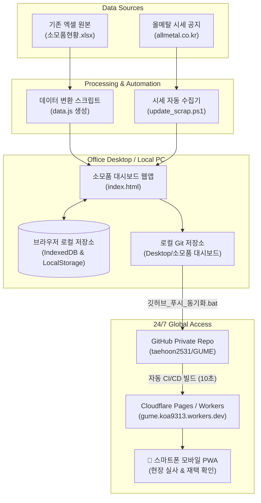

# 📄 [PRD] (주)에스앤더블류 소모품 구매 관리 및 폐초경 시세 모니터링 대시보드

---

## 📌 1. 문서 개요 (Document Overview)

| 항목 | 내용 |
| :--- | :--- |
| **프로젝트명** | (주)에스앤더블류 소모품 구매 관리 및 폐스크랩 시세 분석 대시보드 |
| **시스템 영문명** | SNW Supplies Procurement Management & Scrap Market Intelligence System |
| **문서 버전** | v2.2 (Mobile & Cloudflare Deployment Edition) |
| **작성 부서 / 작성자** | 구매부 / 김태훈 대리 (`taehoon2531`) |
| **최종 갱신일** | 2026년 11월 13일 |
| **온라인 배포 주소** | `https://gume.koa9313.workers.dev` (Cloudflare Pages/Workers 연동) |
| **원격 코드 저장소** | Private GitHub Repository (`https://github.com/taehoon2531/GUME`) |

---

## 🎯 2. 프로젝트 배경 및 목적 (Background & Objectives)

### 2.1 추진 배경
1. **엑셀 수동 관리의 한계 극복**
   - 기존에는 45,000건 이상의 방대한 소모품(가공용 인서트 팁, 엔드밀, 드릴, 테이프, 절삭유 등) 구매 내역을 단일 엑셀 파일(`소모품현황.xlsx`)로 관리.
   - 데이터 누적으로 파일 용량이 비대해져 검색·필터링 속도가 현저히 저하되고, 다중 사용자 수정 시 데이터 충돌 및 유실 위험 상존.
2. **품목별 과거 단가 변동 및 거래처 추이 분석 부재**
   - 특정 공구(예: CNMG 인서트 등)의 3~5개년 단가 인상/인하 이력을 즉시 추적하기 어려워, 공급사 견적 검토 시 협상력 발휘에 제약.
   - 월별·거래처별 매입액 추이 및 피벗 분석을 엑셀로 매번 수작업 정리해야 하는 비효율 발생.
3. **공장 내 고부가가치 폐스크랩(폐초경·폐하이스) 매각 자산화 체계화**
   - 기계 가공 공정 후 발생하는 폐인서트 팁, 통초경 엔드밀, HSS 하이스 공구는 고단가 유가금속(텅스텐, 코발트) 자산임에도 불구하고 시장 시세 추적 체계가 없었음.
   - 국내 최대 금속스크랩 거래소(올메탈)의 공지 단가(kg당 33,000원 ~ 100,000원 급변동)를 모니터링하여 **최고가 매각 타이밍을 포착**할 필요성 대두.
4. **시공간 제약 없는 모바일 및 원격 업무 지원**
   - 사무실 PC 앞에서만 데이터를 볼 수 있었던 환경을 탈피하여, 공장 현장 실사, 출장, 재택근무 시에도 스마트폰으로 즉시 단가와 시세를 확인할 수 있는 시스템 요구.

### 2.2 핵심 목표 (Key Objectives)
- **속도 혁신**: 45,000+건 대용량 데이터를 0초(지연 없음) 단위로 실시간 검색·필터링.
- **원가 절감**: 품목별 단가 이력 차트를 통한 거래처 견적 타당성 검증 및 단가 인하 협상 기반 마련.
- **수익 극대화**: 폐초경 및 하이스 시세 143회차 변동 추이 모니터링과 매각 간이 계산기를 통해 최적기 매각 수익 창출.
- **업무 자동화**: 월마감 보고서 인쇄 및 엑셀 명세서 편집, 깃허브 푸시, Cloudflare 자동 배포 원클릭화.

---

## 👥 3. 사용자 페르소나 및 핵심 유스케이스 (User Personas & Use Cases)

| 페르소나 | 주요 사용 목적 | 핵심 유스케이스 (Use Cases) |
| :--- | :--- | :--- |
| **구매부 담당자**<br>(주 사용자) | 일상 소모품 발주 검토,<br>거래처 단가 비교, 월마감 정산 | • 신규 발주 전 품목명을 검색하여 최근 3개년 최저·최고 단가 확인<br>• 월말 거래처별 매입액 자동 집계 및 거래명세서 A4 보고서 출력<br>• 엑셀 복사/붙여넣기를 통한 신규 입고 데이터 즉시 웹 동기화 |
| **공장 가공 현장 관리자** | 공구 폐기물 수거 및<br>스크랩 매각 시점 결정 | • 공구실에 모인 폐초경 팁 및 폐하이스 중량 측정 후 예상 매각 대금 계산<br>• 올메탈 주차별 시세가 저점 반등 구간인지 확인 후 고물상 수거 일정 확정 |
| **구매팀장 및 임원** | 구매 예산 통제 및<br>업체별 편중도 모니터링 | • 거래처별 매입추이 그래프에서 주요 벤더별 연간 매입 비중 확인<br>• 스마트폰으로 외부에서도 특정 규격 단가 및 월마감 현황 신속 결재·참조 |

---

## 🏗️ 4. 시스템 아키텍처 및 기술 스택 (System Architecture)

본 시스템은 외부 서버 비용이 발생하지 않고(100% Free Tier), 보안성이 뛰어나며, 인터넷 연결이 불안정해도 로컬에서 완벽하게 작동하는 **Local-First & Serverless JAMstack** 아키텍처를 채택했습니다.



### 4.1 기술 스택 명세

| 구분 | 적용 기술 | 선정 이유 및 역할 |
| :--- | :--- | :--- |
| **프론트엔드 코어** | Pure HTML5, CSS3, ES6+ JavaScript | 무거운 프레임워크(React/Vue 등) 없이 빌드 의존성을 배제하여 단일 파일(`index.html`)만으로 초경량·초고속 로딩 보장 |
| **차트 엔진** | HTML5 Native Canvas API | 무거운 외부 차트 라이브러리 없이 픽셀 단위로 커스텀 렌더링. 마우스 호버 툴팁, 크로스헤어, 다크모드 실시간 색상 반전 지원 |
| **클라이언트 스토리지** | IndexedDB, Web LocalStorage | 45,000건 대용량 데이터의 브라우저 로컬 인덱싱 및 명세서 편집 캐시 보존 |
| **타이포그래피** | Pretendard Variable CDN | 숫자 및 코드 가독성에 최적화된 고품질 고딕 웹폰트 적용 |
| **버전 관리** | MinGit (v2.56.1), GitHub | 사내 구매 단가 보호를 위한 **Private(비공개) 저장소** 운용 |
| **클라우드 호스팅** | Cloudflare Pages / Workers | 무제한 대역폭, 무료 SSL, 깃허브 푸시 시 자동 배포 (무서버 24시간 가동) |
| **운영 자동화** | Windows PowerShell 5.1, Batch Scripts | 원클릭 깃허브 푸시/풀, 올메탈 시세 자동 웹크롤러 |

---

## 🧩 5. 상세 기능 명세 (Functional Specifications)

### 📋 모듈 1: 소모품 검색 및 품목별 단가 이력 분석 (`tab-search`)
- **실시간 다차원 필터링**: 품명, 규격, 공급사(업체명), 비고를 입력하는 즉시 0ms 단위로 실시간 검색.
- **기간 범위 지정**: 시작일~종료일 캘린더 피커를 통한 입고일자 필터링.
- **원클릭 빠른 검색 칩스 (Mobile/Desktop)**: `[전체]`, `[인서트]`, `[엔드밀]`, `[드릴]`, `[테이프]`, `[오일]`, `[장갑]`, `[가스]` 터치 시 즉시 필터링.
- **품목별 과거 단가 변동 팝업 차트**:
  - 행(Row) 클릭 시 모달 창 호출.
  - 해당 품목의 과거 전 회차 입고 단가를 시간순 꺾은선 캔버스 그래프로 시각화.
  - 최저 단가, 최고 단가, 평균 단가 뱃지 및 전회 대비 변동률 자동 산출.
  - 최근 1년, 3년, 5년, 전체 기간 필터링 버튼 제공.
- **데이터 내보내기**: 현재 필터링된 검색 결과를 UTF-8 BOM CSV(엑셀 호환) 파일로 즉시 다운로드.

---

### 📈 모듈 2: 거래처별 매입추이 피벗 분석 (`tab-trends`)
- **동적 피벗 매트릭스**:
  - 가로축: 월별(YYYY-MM, 최근 6개월/12개월/24개월/전체 선택).
  - 세로축: 거래처 목록.
  - 교차점: 해당 월 거래처 매입 공급가액 합산액 표시.
- **상호작용형 월별 매입 추이 막대 그래프**:
  - 그래프 막대에 마우스 포인터 호버 시 **해당 월 거래처명, 매입액, 구매 건수 툴팁** 표시.
  - 피벗 테이블 하단 거래처명을 클릭 시, **해당 거래처 단독 매입 그래프로 즉시 연동 필터링**.
- **매입 상위 TOP 벤더 및 품목 비중 차트**: 매입 집중도 파악을 위한 랭킹 바 차트 제공.

---

### 📅 모듈 3: 월마감 결산 및 거래처별 구매현황 보고서 (`tab-closing`)
- **월마감 자동 집계**: 대상 연월 및 거래처를 선택하면 해당 월 입고 데이터 자동 추출.
- **공식 A4 규격 거래명세서 양식 출력**:
  - (주)에스앤더블류 회사 정보, 공급자 정보, 품목명, 규격, 수량, 단가, 공급가액, 세액 자동 산출.
  - 브라우저 인쇄(`Ctrl+P`) 시 보고서 외 UI 요소를 숨기고 A4 1장에 맞춘 깔끔한 출력 서식 적용.
- **웹 브라우저 엑셀 스프레드시트 편집기**:
  - 원본 데이터를 손상시키지 않고, 화면 상에서 직접 셀을 클릭해 수량, 단가, 비고를 수정하거나 신규 행을 추가 가능.
  - 수정된 명세서는 로컬 스토리지에 캐시되어 재접속 시에도 유지되며, 수정본 CSV 별도 저장 지원.

---

### 💎 모듈 4: 올메탈 폐초경 및 하이스 시세 모니터링 (`tab-scrap`)
- **143회차 과거 공지 데이터베이스 탑재**:
  - 2025년 2월 3일(14회)부터 2026년 11월 5일(173회)까지 전체 시세 데이터 내장.
- **최신 핵심 스크랩 단가 현황판 (KPI)**:
  - 🪙 **폐초경 (인서트 팁)**: 60,000원 / kg (전회 대비 변동폭 및 등락률 뱃지)
  - 🔪 **폐초경 (엔드밀/드릴)**: 80,000원 / kg
  - 🪨 **초경 (덩어리/블록)**: 57,500원 / kg
  - ⚙️ **HSS (하이스 공구)**: 5,500원 / kg
- **🧮 초경 & 하이스 복합 매각 예상 수익 계산기**:
  - 폐초경 팁 보관 중량(kg) 및 폐하이스 중량(kg) 개별 입력.
  - 모바일 터치용 `[-10]`, `[+10]`, `[+50kg]` 원터치 증감 버튼 탑재.
  - 초경 매각 소계 + 하이스 매각 소계 ➔ **총 예상 매각 대금 실시간 합산**.
- **2025~2026 주차별 시세 변동 추이 캔버스 차트**:
  - 품목별 전환 버튼(팁, 엔드밀, 덩어리, 하이스).
  - 2026년 6월 최고점(100,000원), 10월 최저점(40,000원) 뱃지 자동 계산.
  - 마우스/터치 호버 시 해당 공지 일자, 단가, 등락폭, 게시글 제목 툴팁 표시.
- **공지 이력 검색 테이블 & 올메탈 원문 다이렉트 링크**:
  - 각 회차별 `보기 ↗` 클릭 시 공식 올메탈 게시글 원문으로 새창 이동.
  - 전체 시세 이력 엑셀(CSV) 다운로드 지원.

---

### 🏢 모듈 5: 거래처 정보 및 담당자 관리 (`tab-vendors`)
- 거래처명, 대표 담당자, 연락처, 취급 품목 및 비고사항 등록/수정/삭제.
- 거래처별 총 누적 거래액 및 거래 품목수 현황 제공.
- 거래처 명부 엑셀(CSV) 내보내기 기능.

---

### 🔄 모듈 6: 데이터 동기화 & 엑셀 직접 복사/붙여넣기 (`tab-sync`)
- **엑셀 셀 직접 복사/붙여넣기 (Ctrl+C ➔ Ctrl+V)**:
  - 엑셀 프로그램에서 표 영역을 복사한 뒤 웹 화면에서 `Ctrl+V`를 누르면 브라우저 테이블로 즉시 파싱.
  - [기존 데이터에 누적 추가] 또는 [전체 데이터 완전 교체] 모드 선택 가능.
- **자동 백업 & 복구**:
  - 최신 반영 데이터는 브라우저 IndexedDB에 영구 저장.
  - 원클릭으로 최신 `data.js` 다운로드 및 백업 JSON 생성.

---

## 📱 6. 모바일 웹앱 (PWA & Responsive UX) 명세

스마트폰 현장 실사 및 이동 중 조회를 위해 금융/이커머스 앱(토스, 쿠팡) 수준의 모바일 전용 인터페이스를 구축했습니다.

```
┌───────────────────────────────────────────────┐
│ 📦 에스앤더블류 소모품 대시보드         🌙 ⛶  │ ➔ 상단: 컴팩트 타이틀 바
├───────────────────────────────────────────────┤
│ [전체] [인서트] [엔드밀] [드릴] [테이프] [오일]   │ ➔ ⚡ 가로 스와이프 빠른 검색 칩
├───────────────────────────────────────────────┤
│ ┌───────────────────────────────────────────┐ │
│ │ CNMG120408-MA ■ VP15TF                    │ │ ➔ 📱 모바일 전용 카드형 리스트
│ │ 🏢 하나테크 · 📅 2026-03-15                │ │    (PC 테이블을 세로 카드로 변환)
│ │ 수량 100개                    1,450,000원 ›│ │    (터치 시 과거 단가 팝업 차트)
│ └───────────────────────────────────────────┘ │
│ ┌───────────────────────────────────────────┐ │
│ │ 🪙 폐초경 팁 시세 (60,000원/kg)            │ │ ➔ 💎 폐팁 계산기 모바일 최적화
│ │ 중량: [ 50 ] kg  [-10] [+10] [+50kg]      │ │    (원터치 중량 증감 버튼 지원)
│ │ 💰 총 예상 매각 대금: 3,550,000원           │ │
│ └───────────────────────────────────────────┘ │
├───────────────────────────────────────────────┤
│   [📋검색]   [💎폐팁]   [📈추이]   [📅마감]   [🏢거래처] │ ➔ 📱 하단 고정 탭바 (엄지손가락 터치)
└───────────────────────────────────────────────┘
```

1. **하단 고정 네비게이션 탭바 (Mobile Bottom Nav)**
   - 한 손 조작이 용이하도록 화면 하단에 5대 탭 고정 배치.
   - iPhone 홈 인디케이터 영역 대응 (`env(safe-area-inset-bottom)`).
2. **모바일 카드 뷰 (Mobile Card List)**
   - 작은 화면에서 8개 열 테이블을 가로 스크롤하는 불편을 해소하고, `품명/규격`, `거래처/일자`, `수량/공급가액`을 카드 한 장에 시원하게 표시.
3. **PWA 홈 화면 앱 모드**
   - iOS 사파리 및 안드로이드 크롬의 '홈 화면에 추가' 지원.
   - 실행 시 브라우저 주소창이 제거되어 네이티브 앱처럼 풀스크린 실행.

---

## 🔒 7. 보안 및 클라우드 배포 파이프라인 (Security & CI/CD)

1. **비공개 저장소 기반 보안 (Confidentiality)**
   - 사내 소모품 단가 및 거래처 정보는 대외비 자산이므로 GitHub 저장소를 **Private(비공개)**로 설정.
   - 제3자 검색 및 외부 무단 열람 원천 차단.
2. **Cloudflare Pages 무중단 자동 배포 파이프라인**
   - 사무실 PC에서 **[깃허브_푸시_동기화.bat]** 실행 시 Git 커밋 & 푸시 진행.
   - Cloudflare 서버가 깃허브 푸시를 즉각 감지하여 10~20초 이내에 글로벌 CDN 에지에 자동 빌드 및 배포 완료.
   - 별도 서버 호스팅 비용 **0원(완전 무료)**.

---

## 🛠️ 8. 운영 및 유지보수 워크플로우 (Operational Guide)

### 8.1 신규 소모품 입고 데이터 갱신 시
1. 회사 PC에서 대시보드 실행 후 **[🔄 데이터 동기화]** 탭 진입.
2. 엑셀의 신규 행을 복사(`Ctrl+C`)하여 붙여넣기(`Ctrl+V`) 후 [데이터 반영] 클릭.
3. 바탕화면의 **[깃허브_푸시_동기화.bat](file:///c:/Users/user/Desktop/소모품%20대시보드/깃허브_푸시_동기화.bat)** 더블클릭 ➔ 스마트폰과 집 PC까지 자동 동기화 완료.

### 8.2 올메탈 신규 폐초경 시세 업데이트 시
1. 올메탈에 174번 이후 새 공지가 올라오면, 바탕화면의 **[폐팁시세_업데이트.bat](file:///c:/Users/user/Desktop/소모품%20대시보드/폐팁시세_업데이트.bat)** 더블클릭.
2. 스크립트가 신규 공지를 자동 크롤링하여 `scrap_prices.json` 및 `scrap_data.js` 자동 갱신.
3. **[깃허브_푸시_동기화.bat]** 더블클릭으로 클라우드 동기화 완료.

---

## 🚀 9. 향후 고도화 로드맵 (Future Roadmap)

- [ ] **안전재고 및 재발주 시점 자동 알림**: 과거 월평균 소모량을 기반으로 핵심 가공 팁의 재고 부족 위험 자동 경고.
- [ ] **공급업체 단가 인상률 비교 리포트**: 연초 단가 계약 갱신 시 거래처별 전년 대비 품목 인상률 자동 산출.
- [ ] **Cloudflare Access(Zero Trust) PIN 번호 2차 인증 도입**: 브라우저 접속 시 4자리 PIN 코드 잠금 화면 추가로 보안 강화.

---

*(주)에스앤더블류 구매부 · 본 문서는 프로젝트 소스코드 저장소의 `PRD.md`에 영구 보존됩니다.*
